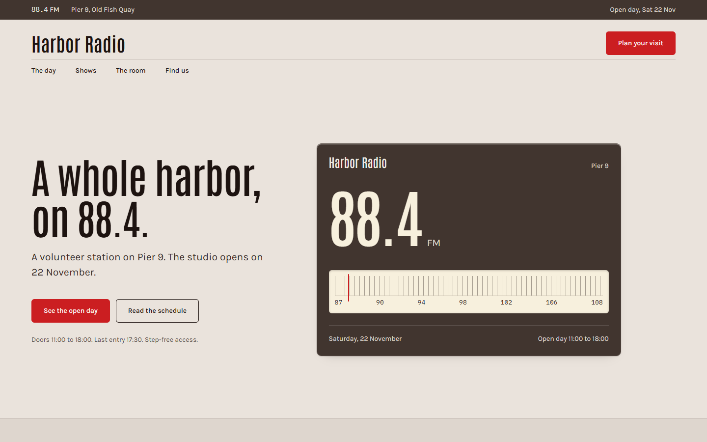
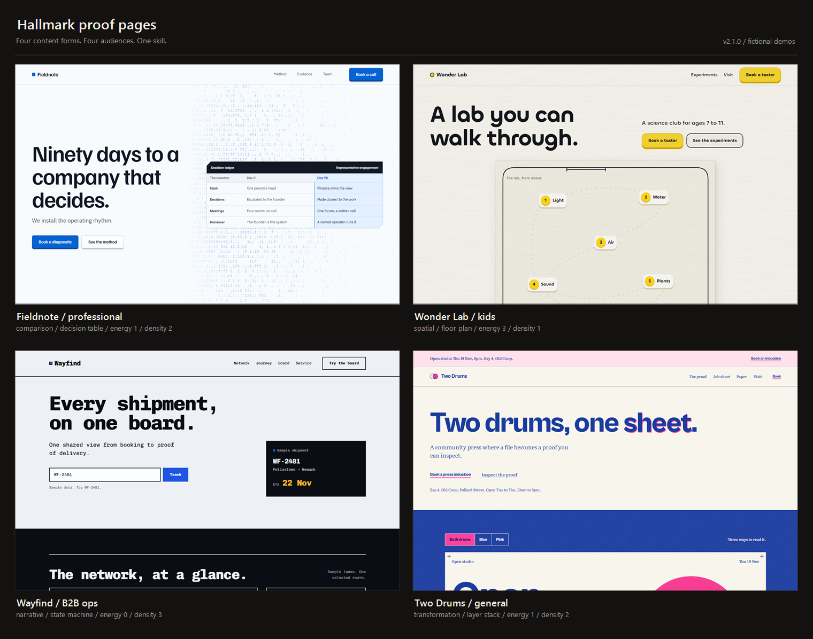

# PowerUI

**A design skill for AI coding agents: pages that look made, not generated.**

[](https://github.com/Vijay00891/frontend-ai-skill/actions/workflows/verify.yml)



<sub>Original PowerUI material: the Receiver theme and the Harbor Radio proof page. The station, its shows and all sample details are fictional.</sub>

PowerUI installs a design process into Claude Code, Codex, Cursor or OpenCode. It is not a component library. It asks once, reads the project, chooses a direction, builds one clear idea, and sweeps the result against a measurable floor.

The normal workflow is one command: install once, then ask for a page with `/powerui <prompt>`. The agent runs project fit, build, checks, fixes and the proof report internally. You do not run a second command to test, screenshot or export the result.

`2.2.0` | MIT | Node 18+ | [npm](https://www.npmjs.com/package/powerui-skill) | [examples](examples/) | [skill](powerui/SKILL.md)

## Quick start

1. Install [Node.js](https://nodejs.org/) 18 or newer.
2. Install the skill:

   ```sh
   npx powerui-skill --dry-run
   npx powerui-skill
   ```

   The first command only prints what would happen. The second installs PowerUI into every supported harness it detects. After that, the only step is the prompt below.

3. Ask PowerUI for a page:

   | Harness | Command |
   | --- | --- |
   | Claude Code | `/powerui a booking page for a neighborhood print studio` |
   | Cursor | `/powerui a booking page for a neighborhood print studio` |
   | OpenCode | `/powerui a booking page for a neighborhood print studio` |
   | Codex CLI | `$powerui a booking page for a neighborhood print studio` |

   Natural language also works: *"Use the PowerUI skill to design a booking page for a neighborhood print studio."*

The npm package is named `powerui-skill`. Its installer command is `powerui`. The skill itself needs no other public command: it scans the project, builds, checks and reports inside the `/powerui` run.

## Install

The installer validates the skill before copying it. It does not add dependencies to your project or change your project files.

### From npm (recommended)

```sh
npx powerui-skill
```

For a permanent command:

```sh
npm install -g powerui-skill
powerui --dry-run
powerui
```

PowerUI installs here:

| Harness | Install path |
| --- | --- |
| Claude Code | `~/.claude/skills/powerui` |
| Codex CLI / Cursor | `~/.agents/skills/powerui` |
| OpenCode | `~/.config/opencode/skills/powerui` or the Claude/Codex compatibility path |

If PowerUI cannot detect a harness, name one explicitly:

```sh
npx powerui-skill --claude
npx powerui-skill --codex
npx powerui-skill --cursor
npx powerui-skill --opencode
```

OpenCode normally reads the Claude Code or Codex copy. To give it a separate copy:

```sh
npx powerui-skill --opencode --copy
```

Useful installer options:

```text
--dry-run   Print the destinations and change nothing
--copy      Give OpenCode its own copy
--force     Install even if validation finds a problem
--remove    Remove every installed copy
--version   Print the PowerUI version
--help      Show the installer help
```

`--force` is only for cases where you have read the validation findings and still want to proceed. `--remove` removes all known copies, including an older Codex copy.

### From source

Use this when you want the examples or are working on the skill:

```sh
git clone https://github.com/Vijay00891/frontend-ai-skill.git
cd frontend-ai-skill/powerui
node scripts/install.mjs --dry-run
node scripts/install.mjs
```

A manual install also works: copy the whole `powerui/` folder into your harness's skills directory, keeping `SKILL.md` at its root.

## User guide

### 1. Start a design

Ask for a new page in your harness:

```text
/powerui design a booking page for a neighborhood print studio
```

In Codex:

```text
$powerui design a booking page for a neighborhood print studio
```

The skill is for new pages and designs. To work on an existing design, name PowerUI explicitly and use one of its verbs:

```text
/powerui redesign path/to/page.html
/powerui audit path/to/page.html
```

`redesign` keeps the page's content and wiring while replacing the design. `audit` returns a report. Do not use PowerUI on an existing design unless you explicitly ask for one of these modes.

### 2. Answer one ask

PowerUI asks once for four things:

- **Material:** what the page is about and what content it has.
- **Audience:** who it is for.
- **Use:** what the visitor should do.
- **Tone:** how it should feel.

It then shows a compact **Picks** block and builds. If you say **go ahead**, it infers those fields and states what it picked instead of silently guessing. It does not invent metrics, testimonials, logos, prices or case-study counts.

### 3. Review the result

The examples produce plain HTML and CSS with a `tokens.css`, a `base.css`, and a PowerUI stamp at the top of the stylesheet. In a framework project, PowerUI reuses the project's tokens and appends to its stylesheet instead.

PowerUI writes `.powerui/contract.json` when it scans a project, and `.powerui/proof.json` plus a readable proof summary after the sweep. The final message reports what was built, the proof verdict, which checks ran or were skipped, and any unresolved finding with its file and line.

You do not need to run the sweep yourself. If the page is not clean, ask PowerUI to fix the findings; it reruns the proof. The proof report is evidence, not a waiver: a skipped render or a remaining warning is reported as skipped or warned.

### 4. Update or remove

Re-run the installer to replace an installed copy with the current package:

```sh
npx powerui-skill
```

If you installed the global command, update the package and reinstall:

```sh
npm install -g powerui-skill@latest
powerui
```

Remove every installed copy with:

```sh
npx powerui-skill --remove
```

or, with the global command:

```sh
powerui --remove
```

## Why PowerUI

Most generated frontends converge: the same purple gradient, three floating cards, a testimonial nobody gave. PowerUI exists to break that convergence without making the page dishonest.

- **A hard Floor.** Sixteen non-waivable rules cover tokens, motion, focus, overflow, fold, labels, honesty and the page stamp. A page that fails the Floor is not PowerUI.
- **One ask.** Material, audience, use and tone arrive in one message. If you say "go ahead", the skill infers and states what it picked; it never invents a fact.
- **Project fit.** Before designing, PowerUI scans the project's existing fonts, palette, type scale, spacing and framework and writes a design contract. A theme adds shape and composition; it does not overwrite a working project system.
- **A dealt direction.** Forty-five inherited material themes plus the original Receiver theme cover paper, ink, faces, surfaces, motion and voice. They are dealt against a log so consecutive builds do not repeat.
- **An idea from the content.** The skill names the content's shape, considers six mechanisms, and builds the one that fits best.
- **Original proof.** Harbor Radio is the first original PowerUI proof page, built in the original Receiver theme. The four inherited Hallmark pages remain as additional proof.
- **A sweep with evidence.** `sloplint` checks the page, the gates are walked, a fresh-context review tests the idea, and the proof report records findings, contract usage and the screenshots the render tier produced.
- **Honest proof.** No invented metrics, quotes, logos or case-study counts. Missing material is named as absent, or replaced with a library stand-in you can swap.

The full operating manual is [`powerui/SKILL.md`](powerui/SKILL.md). The references hold the layout, craft, genre, imagery, niche, information-form, gate and theme material.

## What is inside

```text
powerui/
  SKILL.md             the flow, the Floor, the gates and the hand-off
  package.json         npm metadata and the `powerui` command
  README.md            npm install and use instructions
  references/          automatic flow, layout, craft, genres, imagery, niche,
                       information forms, 21 macrostructures, 46 theme
                       definitions and pictures, gates
  scripts/             fit, theme deal/draw/scaffold/log, sloplint, proof, capture,
                       picture, installer, checks and tests
  agents/openai.yaml   Codex/agent metadata
  LICENSE              MIT
examples/              four inherited proof pages, one original proof page and images
```

The 45 inherited themes and the four inherited examples are Hallmark material. The Receiver theme, the Harbor Radio proof page, the automatic project-fit contract and the proof report are original PowerUI work. Run `node scripts/theme.mjs list` to print the theme names.

## Examples

### Original PowerUI

| Page | Audience | Content form | Idea | Theme |
| --- | --- | --- | --- | --- |
| [Harbor Radio](examples/radio/index.html) | general | time | tuning-scale schedule | Receiver |

Harbor Radio is a fictional volunteer station on Pier 9. The day is one continuous tuning scale from 06:00 to midnight, not a row of equal cards; the receiver panel and the schedule share the same dial language. The page is built in Receiver, the first original PowerUI theme, and passes the rendered proof with 0 FAIL, 0 REFLEX and 0 WARN.

### Inherited Hallmark



| Page | Audience | Content form | Idea | Theme |
| --- | --- | --- | --- | --- |
| [Fieldnote](examples/professional/index.html) | professional | comparison | decision table | Cobalt |
| [Wonder Lab](examples/kids/index.html) | kids | spatial | floor plan | Hum |
| [Wayfind](examples/b2b/index.html) | B2B ops | narrative | state machine | Wayfind |
| [Two Drums](examples/studio/index.html) | general | transformation | layer stack | Riso |

The pages are static and need no build. Open any `index.html` directly, or serve the `examples/` folder with any static file server.

All five brands, their copy and sample data are fictional; the station, its shows and its people are invented. There are no real client metrics, testimonials, logos or case studies in these pages. Other than the station's mail link on Harbor Radio, the pages have no working forms or backend.

## Development

From the `powerui/` folder:

```sh
node scripts/refcheck.mjs
node scripts/install.mjs --dry-run
node --test scripts/*.test.mjs
npm pack --dry-run
```

Maintainer-only checks, never required from a user:

```sh
node scripts/fit.mjs scan --root ..
node scripts/sloplint.mjs ../examples/professional/index.html --genre editorial
node scripts/proof.mjs ../examples/professional/index.html --genre editorial --no-render
```

The suite reports 14 passing tests, 0 failing, and 11 optional browser regressions skipped. The browser tests activate when `POWERUI_PUPPETEER` and `CHROME_PATH` (capture) or `POWERUI_TEST_PUPPETEER` and `POWERUI_TEST_CHROME` (render regressions) are set.

The static lint is dependency-free. `--render` needs Chrome or Chromium and `puppeteer-core`. Set `POWERUI_PUPPETEER` to a folder containing `node_modules/puppeteer-core` and `CHROME_PATH` to the browser if auto-detection misses. The render tier writes screenshots beside the page under `.powerui/`, which is ignored by this repository.

## Requirements

- **Node 18+** for the installer, theme tools, sloplint and checks.
- **A skills-capable harness:** Claude Code, Codex CLI, Cursor or OpenCode.
- **Optional:** Chrome or Chromium and `puppeteer-core` for rendered screenshots and `--render`.
- **Optional:** `TOGETHER_API_KEY` for the optional comp/image step.

The core design flow works without the optional items.

## License and attribution

MIT. See [LICENSE](LICENSE). The skill and the original proof pages are covered by the same license. Copyright (c) 2026 PowerUI contributors.

PowerUI began from Hallmark, the original design skill by Nutlope and contributors. Their copyright notice and the MIT permission notice are preserved in [LICENSE](LICENSE). The 45 inherited themes and the four inherited examples remain Hallmark material; the Receiver theme, the Harbor Radio proof page, the project-fit contract and the proof report are original PowerUI work. See [ATTRIBUTION.md](ATTRIBUTION.md) for the exact split.

The Harbor Radio page includes photographs by [The Midnite Wolf](https://commons.wikimedia.org/wiki/File:Shure_SM7.jpg) (CC0) and [ArildV](https://commons.wikimedia.org/wiki/File:Newlyn_old_harbour_pier_July_2026_01.jpg) (CC BY-SA 4.0), both from Wikimedia Commons. Those images keep their own licenses; the page carries their credits.

PowerUI is powered by Together AI. The example pages load type from Google Fonts and Fontshare under those providers' terms; no font files are bundled. No analytics or backend are included.

## Contributing

Issues and pull requests are welcome. Keep the Floor, the gates, the honesty rules and the one-ask flow intact. Do not add invented proof to the examples. Run the checks above before opening a pull request.
