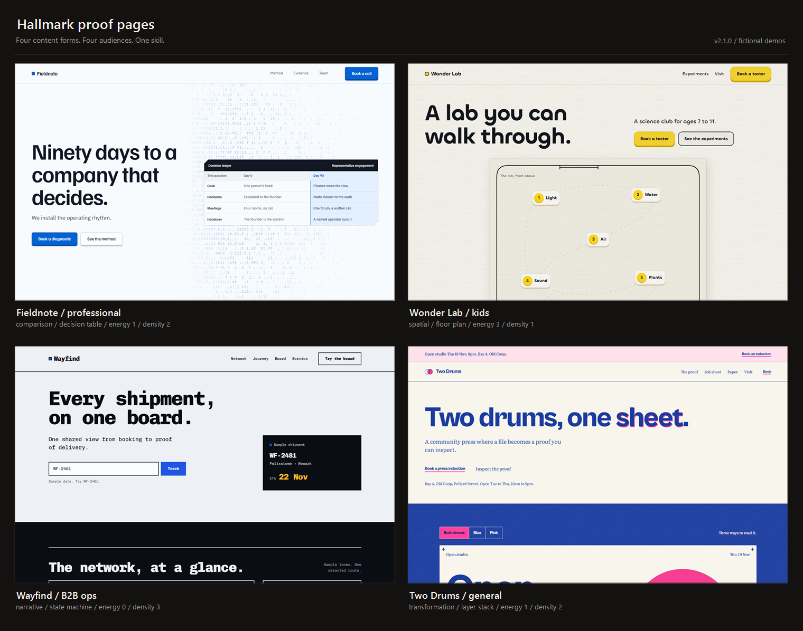

# PowerUI proof pages

Four static pages inherited from Hallmark and included with PowerUI v2.2.0. They remain proof that the underlying process can produce different content forms for different audiences without falling back on the same layout.



| Page | Audience | Content form | Idea | Theme |
| --- | --- | --- | --- | --- |
| [Fieldnote](professional/index.html) | professional | comparison | decision table | Cobalt |
| [Wonder Lab](kids/index.html) | kids | spatial | floor plan | Hum |
| [Wayfind](b2b/index.html) | B2B ops | narrative | state machine | Wayfind |
| [Two Drums](studio/index.html) | general | transformation | layer stack | Riso |

## Open them

There is no build step. Open any `index.html` directly, or serve the folder with any static file server:

```sh
cd frontend-ai-skill/examples
npx serve .
```

The pages load fonts from Google Fonts and Fontshare, so they fall back to local faces offline. The forms are demonstrations and submit nowhere.

## What each page shows

- **Fieldnote** — a consulting decision ledger. The page is built around a comparison of Day 0 and Day 90, not a row of service cards. The signature is the ledger's second column.
- **Wonder Lab** — a science club for ages 7–11. The page is a floor plan with a numbered route through the lab; the map's path fills as experiments are tried. The motion stays within the kids' ceiling.
- **Wayfind** — a shipment board for ops. The page is a state machine: a sample shipment moves through network, journey, board and delivery, with the same route driving the map and the board.
- **Two Drums** — a community print studio. The page is a layer stack: the proof separates into its blue and pink drums, and the layer control changes what the visitor sees. The print marks are made in CSS, not a decorative illustration.

All brands, names, copy and sample data are fictional. No real client metrics, testimonials, logos or case studies appear in these pages.

## Not a component library

These are finished compositions, not a kit to copy section by section. The skill's process and the `powerui/references/` library are the reusable part; the pages are the evidence that the process produces more than one kind of result.

See [`../powerui/SKILL.md`](../powerui/SKILL.md) for the flow, the Floor and the gates.

## License

MIT. See [`../LICENSE`](../LICENSE).
