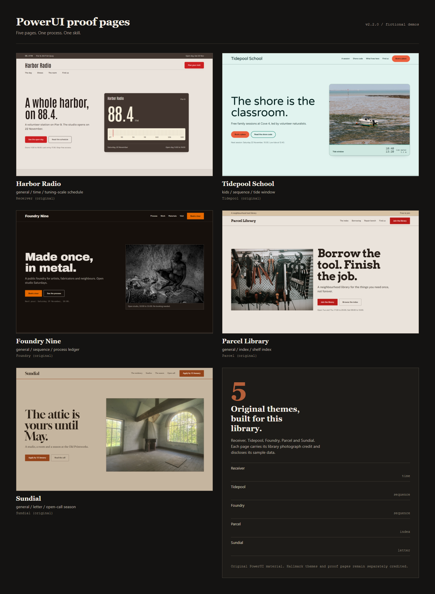

# PowerUI proof pages

PowerUI carries nine finished static proof pages: five original PowerUI pages and four inherited from Hallmark. They show that the process can produce different content forms for different audiences without falling back on the same layout.



## Original PowerUI

The five pages below are new PowerUI work. Their themes are original materials, not renamed Hallmark themes.

| Page | Audience | Content form | Idea | Job | Theme |
| --- | --- | --- | --- | --- | --- |
| [Harbor Radio](radio/index.html) | general | time | tuning-scale schedule | visit the open day | Receiver |
| [Tidepool School](tidepool/index.html) | kids | sequence | tide window | book a shore session | Tidepool |
| [Foundry Nine](foundry/index.html) | general | sequence | process ledger | book a tour | Foundry |
| [Parcel Library](parcel/index.html) | general | index | shelf index | join the library | Parcel |
| [Sundial](sundial/index.html) | general | letter | open-call season | apply to the residency | Sundial |

All five report 0 FAIL, 0 REFLEX and 0 WARN with rendered screenshots at 1280, 1440, 1920 and 375.

### Harbor Radio

Harbor Radio is a fictional volunteer station on Pier 9. The page is built around one tuning scale: the day's schedule is a continuous band from 06:00 to midnight, the receiver panel and the selected show share the same dial language, and the open-day table is the visit route. It is set in Receiver.

Photographs: [The Midnite Wolf](https://commons.wikimedia.org/wiki/File:Shure_SM7.jpg) (CC0) and [ArildV](https://commons.wikimedia.org/wiki/File:Newlyn_old_harbour_pier_July_2026_01.jpg) (CC BY-SA 4.0), both from Wikimedia Commons.

### Tidepool School

Tidepool School is a fictional family shore school at Cove 4, Bracken Bay. The page follows one session from arrival to the tide window; the timetable is the route, and the field guide is made from the creatures the page names. It is set in Tidepool.

Photograph: [Low tide in Rivedoux, Ré island](https://commons.wikimedia.org/wiki/File:Low_tide_in_Rivedoux,_R%C3%A9_island,_august_2015.jpg) by Jebulon (CC0, Wikimedia Commons).

### Foundry Nine

Foundry Nine is a fictional public metal workshop for artists, fabricators and neighbours. The page is a process ledger from pattern to pour, with a materials shelf and an open-studio invitation; the dark surface, hard rules and safety-orange signal carry the foundry. It is set in Foundry.

Photograph: [Blacksmith at work](https://commons.wikimedia.org/wiki/File:Blacksmith_At_Work_02.jpg) by OJjnr (CC BY-SA 4.0, Wikimedia Commons).

### Parcel Library

Parcel Library is a fictional neighbourhood tool library on Mill Lane. The page is a shelf-marked index; the catalogue, borrowing steps and repair bench share one ruled table language. It is set in Parcel.

Photograph: [Various tools hanging on a pegboard](https://commons.wikimedia.org/wiki/File:Various_tools_hanging_on_a_pegboard_in_a_workshop_setting_with_natural_light_filtering_in.jpg) by Shixart1985 (CC BY 2.0, Wikimedia Commons).

### Sundial

Sundial is a fictional artist residency at the Old Printworks in Aubrac. The page is an open call: a letter, a studio table, a season timeline and the details of what to send. It is set in Sundial.

Photograph: [Interior of Camille Pissarro's studio at Éragny-sur-Epte](https://commons.wikimedia.org/wiki/File:Interior_of_Camille_Pissarro_s_studio_at_%C3%89ragny-sur-Epte_-_2026.jpg) by AlexDS05 (CC0, Wikimedia Commons).

## Inherited from Hallmark

Four static pages inherited from Hallmark and included with PowerUI v2.2.0. They remain proof that the underlying process can produce different content forms for different audiences without falling back on the same layout.


| Page | Audience | Content form | Idea | Theme |
| --- | --- | --- | --- | --- |
| [Fieldnote](professional/index.html) | professional | comparison | decision table | Cobalt |
| [Wonder Lab](kids/index.html) | kids | spatial | floor plan | Hum |
| [Wayfind](b2b/index.html) | B2B ops | narrative | state machine | Wayfind |
| [Two Drums](studio/index.html) | general | transformation | layer stack | Riso |

## Open them

There is no build step. Open any `index.html` directly, or serve the folder with any static file server:

```sh
cd frontend-ai-skill/examples
npx serve .
```

The five original pages load Google Fonts; the inherited pages load Google Fonts and Fontshare. They fall back to local faces offline. There is no backend. The original pages use reserved `.example` mail links; the inherited forms are demonstrations and submit nowhere.

## What each inherited page shows

- **Fieldnote**: a consulting decision ledger. The page is built around a comparison of Day 0 and Day 90, not a row of service cards. The signature is the ledger's second column.
- **Wonder Lab**: a science club for ages 7-11. The page is a floor plan with a numbered route through the lab; the map's path fills as experiments are tried. The motion stays within the kids' ceiling.
- **Wayfind**: a shipment board for ops. The page is a state machine: a sample shipment moves through network, journey, board and delivery, with the same route driving the map and the board.
- **Two Drums**: a community print studio. The page is a layer stack: the proof separates into its blue and pink drums, and the layer control changes what the visitor sees. The print marks are made in CSS, not a decorative illustration.

All nine brands, their copy and sample data are fictional; the stations, schools, workshops, libraries, residencies and their people are invented. No real client metrics, testimonials, logos or case studies appear in these pages.

## Not a component library

These are finished compositions, not a kit to copy section by section. The skill's process and the `powerui/references/` library are the reusable part; the pages are the evidence that the process produces more than one kind of result.

See [`../powerui/SKILL.md`](../powerui/SKILL.md) for the flow, the Floor and the gates.

## License

MIT for PowerUI and the inherited Hallmark material. The photographs keep their own licenses, named above and on the pages. See [`../LICENSE`](../LICENSE).
